# 02 使用流程

---

一次在周五的操作，8 步。假设统计日是 2026-10-20（周五）。

## 流程

| #   | 她在做什么             | 页面给她的东西                                   |
| --- | ----------------- | ----------------------------------------- |
| 1   | 15:00 打开邻里券       | 首页第一行就是「今天将要发送 334 人」，不用她自己去算             |
| 2   | 确认统计日对不对          | 页面右上角写了「统计日 2026-10-20」，所有次数都从这天往前推       |
| 3   | 想知道这 334 人是怎么来的   | 三个数旁边一句话写规则：「沉睡客 + 有手机号 + 近 7 日没来过」       |
| 4   | 点「今天将要发送」         | 进入名单页，334 行，每行一个人，带手机号                    |
| 5   | 随手点开一个会员          | 原因页：四项证据逐条列出，每条后面写「是 / 否」                 |
| 6   | 判断这个人该不该发         | 页面上直接写结论：「在名单里，因为……」或「不在名单里，因为……」         |
| 7   | 回到名单，去掉一个她认为不该发的人 | 勾掉后底部从「334 人」变成「333 人」，被去掉的人进「已排除」区，可撤回   |
| 8   | 确认发送              | 二次弹窗写明「向 333 人发送满 99 减 20 券」，确认后页面留一条发送记录 |

## 实机演示

1.运营店员在星期五下午15:00 打开邻里券，看到了如下界面
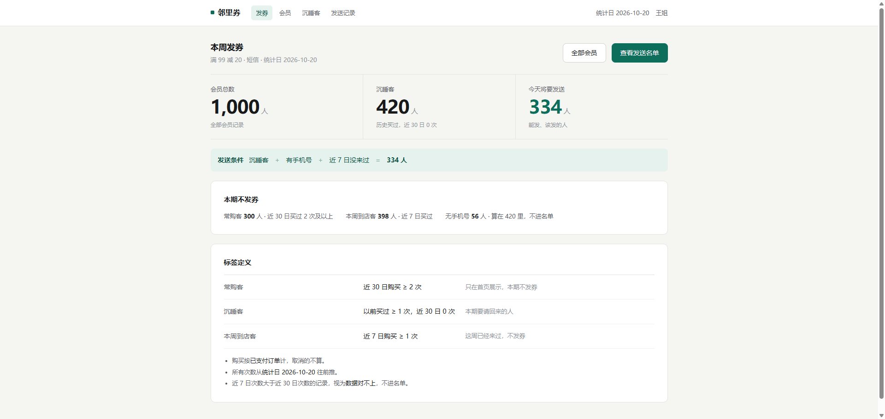

 这里可以看到“会员总数”，“沉睡客”，“今天将要发送”板块，并且在下方附带了发送条件“**发送条件**沉睡客＋有手机号＋近 7 日没来过＝**334 人**”，这是给店员汇报“为什么给这些人发，给什么人发”时候的核心依据。这里的334人是基于数据报表实时渲染出来的。与此同时，三个板块都可以点进去进一步深化。

**2.统计日核算**，店员在使用该产品之前，需要核对统计日是否正确：这里的统计日是数据处理方在更新名单时所确认，口径需要提前对齐，店员在使用该产品之前也需要进行检查核对。实际应用时统计日由数据方在更新名单时给出，产品只显示、不计算。她核对的是「这个日期是不是这一次的」。

**3.各板块点击深入效果：**
**3.1（会员总数板块）**
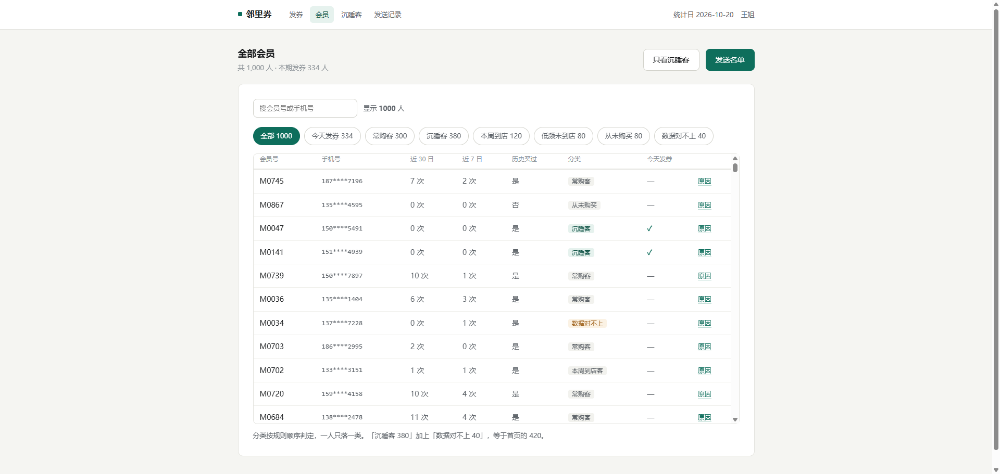

这里显示了全部会员，页面根据给出的数据表格实时渲染，其中细则筛选根据excel中的计算逻辑进行区分排列（下面用“今日发券”与”常购客“进行展示）

今日发券：
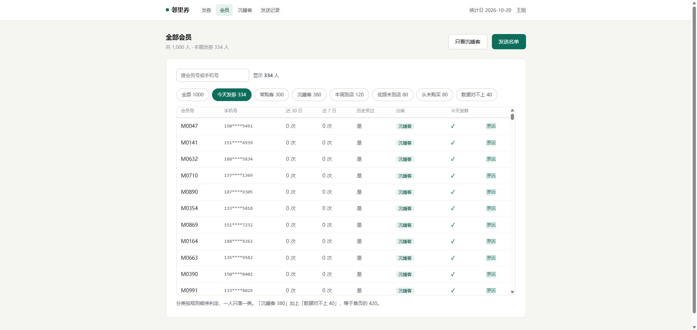 
常购客：
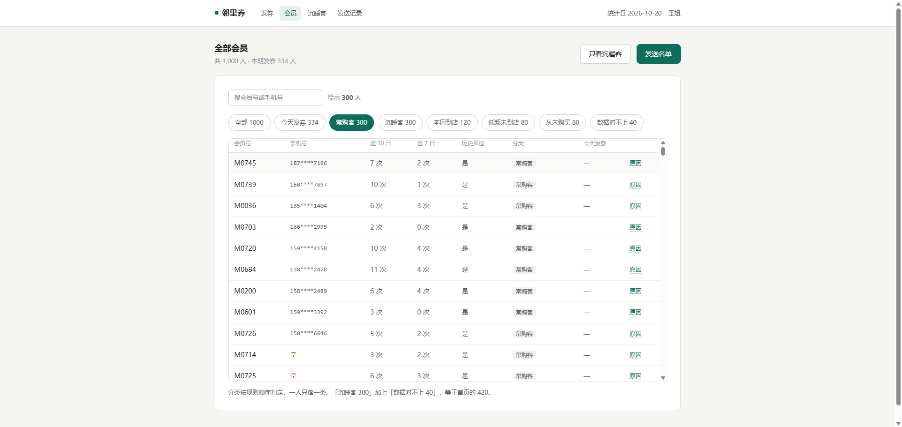 
**3.2（沉睡客板块）**
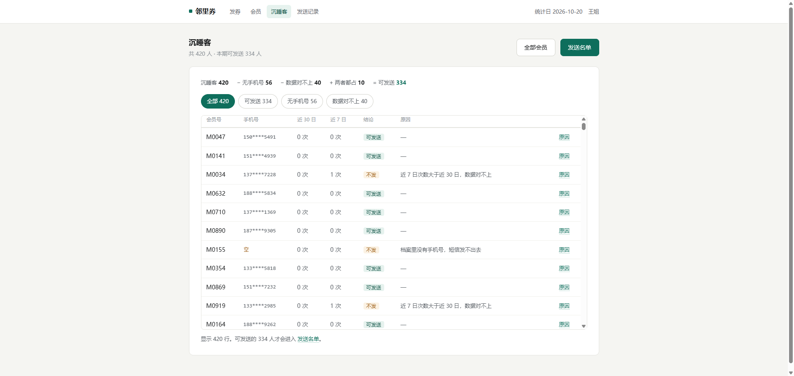

店员点开该板块可以直接看到被标记为“沉睡客”的会员，其中可发送优惠券的沉睡客以及无手机号的会员都会被标记出来，方便以后客人再来时候进行补充。

没有手机号的用户统计界面：
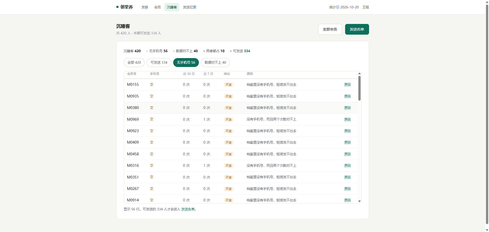 
**3.3发送名单板块**

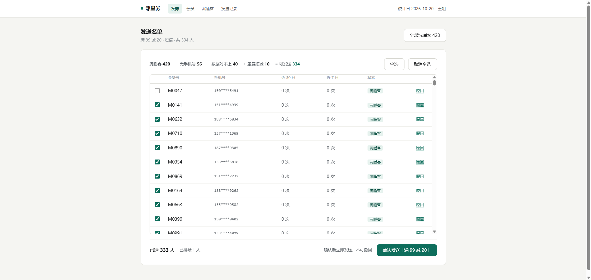 
店员点击进入发送名单板块之后，看到旁边的滑轨可以快速查看上下信息，而且发现发送名单里面的会员账号可以通过勾选来选择想过要发送的对象，这让优惠券的发送变得更加灵活。假设上周店长得知隔壁老李家需要搬走了，那以后不会来超市购物。在可以灵活选择的情况之下店员取消了对于老李的勾选，减少了不必要的优惠券分发。

除此之外，有时候店员想要知道为什么一些用户不符合发送的条件。可以点击每一行最后的“原因”按钮，点击之后会展开对应的细则。

（下面是不同情况下的原因板块）
原因1：可以发送满足条件
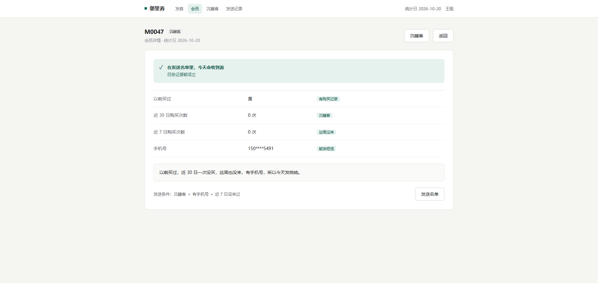 
原因2：数据对不上无法发送
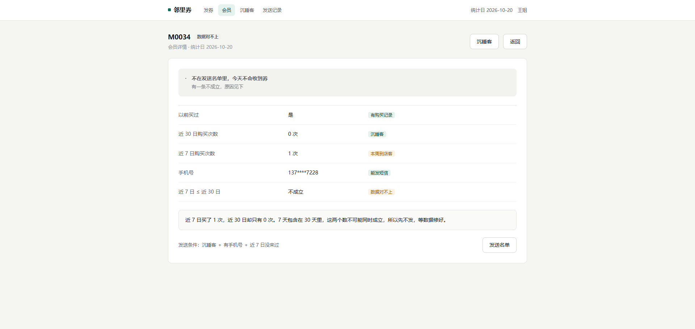

现在有了这个板块直观的信息，店员可以根据需求筛选，然后点击右下角绿色的确认按钮进行优惠券的批量分发。

3.4 发送记录板块
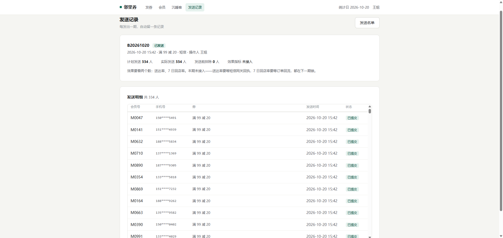

店员在发送完毕之后，会看到底部显示“已向334人发送”的提示信息，（截图是没删人直接发的情况，所以是 334 人）于是店员点进了发送记录板块。这里可以看到对应发送的会员以及信息的发送状态。（这一页现在只有「已提交」，没有「已送达」——回执要接短信网关，本期没接）

这里也可以看到提示信息如下
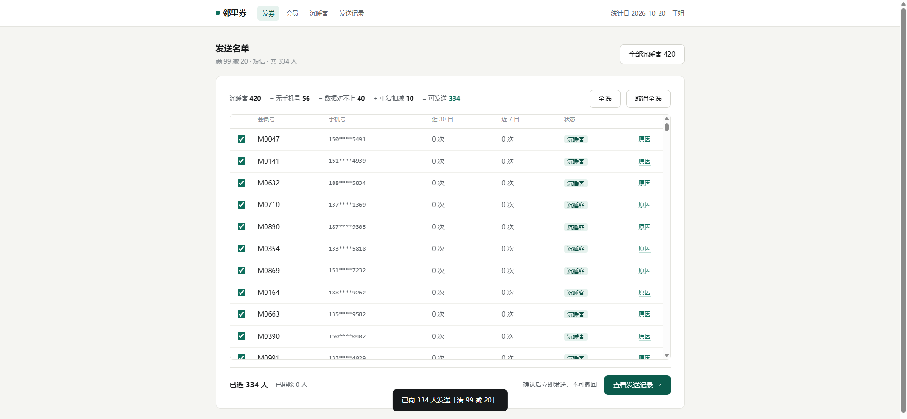 
