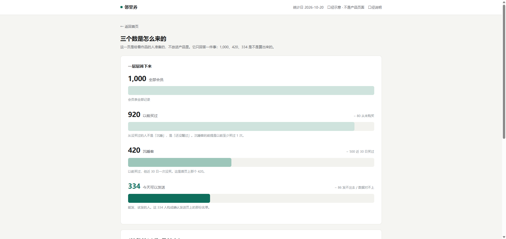
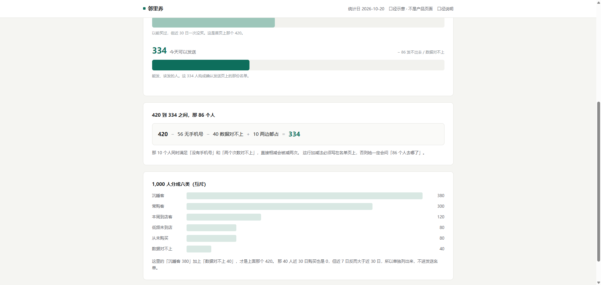
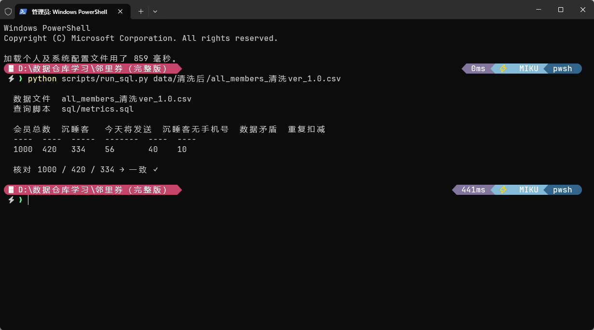

# 邻里券

**每周五打开发券页，看清该请回谁，再确认发送。**

给社区超市的会员运营用。她每周五要决定一批 20 元满减券发给谁。

**虚构说明**：「邻里购」社区超市、店里的 1,000 名会员、全部手机号与购买记录，都是为这个作品编造的样例数据，不对应任何真实的人或企业。本作品是产品设计练习。

郑深源 · 2026 年 10 月

---

## 目录

1. 产品一句话
2. 这期故意不做的事
3. 她怎么用
4. 页面上的数字
5. 发出去之后看哪两个数
6. 规则从哪来

## 一、产品一句话

### 一、使用者是谁

邻里购（社区超市）的会员运营店员。店里有 1,000 名会员，但是这一摊只有她一个人管。

每周五下午，她要发一批「满 99 减 20」的券，把这批“很久没来店里但是有回归潜力的客人”请回店里，这是她的店长下达的任务。

### 二、产品要干什么

**每周五打开发券页，看清该请回谁，再确认发送。**

### 三、用完之后，她能做哪个决定

她能决定这一期的优惠券短信该发给谁，并且对名单里的每一个人，都能说出为什么发；对不在名单里的人，也能说出为什么不发。

**她现在做不了，因为：**

- 她手上只有一个「全体群发」按钮。1,000 人一起发，常来的老客也在里面，券白花。
- 她不知道店里有多少人已经好久没来，也不知道这周谁刚来过。这两件事在系统里没有地方可看。
- 发完之后她说不清这一批到底发给了谁。店长问起来，她只能答「都发了」。

---

## 二、这期故意不做的事

### 取舍一：只做「把人请回来」

**不做：** 新客首单券、生日券、满额加价券、拼团、积分兑换。

**为什么：**

她周五只有一件事要决定——这批券发给谁。每多一种券，她周五就要多做一次判断，而她现在缺的不是券的种类，而是面对上千人的会员数据，里面混杂了大量的购物信息，有的人很久没来，有的人经常来购物，重点是把优惠券给需要吸引回来的人，而不是发给经常光顾或者发给根本不会来的对象。所以只解决“找到真正沉睡客户”的问题

而且其他三种券都不是她周五要处理的对象：新客券的对象是还没进过店的人，生日券按日期触发、不需要她在周五做决定，满额加价券是提升客单价，和她要的「请人回来」是两件相反的事。加进来只会让首页出现四个数、三个按钮，她会关掉页面，回去点那个她熟悉的「全体群发」。

**放弃的代价：** 这个产品帮不了她做大促、也帮不了她拉新。

---

### 取舍二：用三条写死的规则分人，不做「智能推荐模型」

**不做：** 复购概率预测、个性化折扣力度、模型自动选人、A/B 测试分组。

**为什么：**

她必须能向店长解释，为什么这个人收到了。

社区超市的店长认识她的会员。他会指着名单问「为什么给 M0031 发，不给我邻居发」。模型给不出她能复述的理由，她只能答「系统算的」——在一个靠熟人关系做生意的社区店里，这句话等于没回答。

规则写死之后，她点开任何一个人，都能看到证据逐条打勾，可以当场念给店长听。除此之外，作为一个超市运营产品，智能模型的开发成本远大于实际的收益，这只是一个给运营店员快速判断出潜在客户并发送一份优惠券的筛选器，工具要尽量简单、好操作、好维护。智能模型以及复购概率预测的数学模型对于运营团队来说并不是一个好选择，这是背后数据研发团队的事情，在真正一线使用时，也要考虑相关的维修成本以及出错概率。工程开始之前要考虑错误成本，如果模型过于复杂，可以预支付的成本被消耗完，到时候出错带来的停机损失难以挽回。这是这个产品能不能被用起来的前提，比发得准更重要的是发的清楚。

**放弃的代价：** 发得不如模型准。同样一批人，模型可能能多唤回几个。这个代价可以付出，因为用不起来的产品，准确率是零。

---

### 取舍三：近 7 日已经来过的人不发

**不做：** 不把券发给这周已经进店的人，即使她是沉睡客。

**为什么：**

券是用来请人回来的，不是给已经回来的人打折。

这周已经来过的人，说明关系没断，这时候给她一张满 99 减 20，只是把原本就会发生的一笔消费打了个折，直接吃掉毛利。数据上这一条会让人数变少，但少掉的是本来就不该发的人。

这条规则还顺带挡住了一类脏数据：有 40 个人的「近 7 日次数」大于「近 30 日次数」，7 天包含在 30 天里，这在业务上不可能成立。这些人里有的近 30 日记成 0、近 7 日记成 2，按标签算会被判成沉睡客。规则里加上「不是本周到店客」，他们就自然被挡在名单外。

**放弃的代价：** 有一部分人明明是目标人群，因为这周的偶然消费被排除。这周不发，下周还在名单里。

---

### 取舍四：没有手机号的人出现在统计里，但不进入发送名单

**不做：** 不做企业微信推送、不做电话外呼、不做到店核销、不做 App 弹窗。

**为什么：**

这期只做短信。短信发不出去的人，不能算发送成功。

如果名单上写 334、实际只发出去 300，下周她按 334 去复盘，所有数字都是错的——她会以为券没效果，其实是一部分人根本没收到。所以没有手机号的沉睡客留在「沉睡客 420」这个数里（她需要知道店里有 56 个人是联系不上的），但不进名单。

这也给了她一个动作：看到「56 人联系不上」，她会去前台补手机号。这个数字不是用来汇报的，是用来推动一件事的。

**放弃的代价：** 56 个人这一期彻底够不着。他们可能正是最该被请回来的一批。

---

### 取舍五：只展现用户名单筛选结果，不做BI可视化面板

**不做：** bi可视化面板，运营数据版图，回购趋势折线图

**为什么：**

这个工具是给发优惠券的运营店员用的小工具，而不是给店长复盘用的“用户表现计算器”。这个产品开发的重点就是为了解决店员需要发送优惠券的问题。比起用户每周的具体可视化数据，店员更需要的是在每个星期五知道手上的优惠券发给谁才是正确的，把钱花在值得花的人身上。一件事情就对应一个解决方法与最简单的工具，不去创造新的问题，新的可视化面板可以作为拓展在总系统里面添加，并于该产品做关联，而不是给这个产品添加新的复杂功能与问题。

**放弃的代价：** 这个产品待在运营团队的优惠券发送模块里，用作产品执行工具，而不能看到趋势，以及用户变化，或者单独作为一个产品分析工具。店员只能看到「这周发给谁」，看不到「这三个月是不是在变好」。如果店里的沉睡客从 420 涨到 600，她在这个产品里永远发现不了。

---

## 三、她怎么使用

---
一次在周五的操作，8 步。假设统计日是 2026-10-20（周五）。

### 流程

| #   | 她在做什么             | 页面给她的东西                                   |
| --- | ----------------- | ----------------------------------------- |
| 1   | 15:00 打开邻里券       | 首页第一行就是「今天将要发送 334 人」，不用她自己去算             |
| 2   | 确认统计日对不对          | 页面右上角写了「统计日 2026-10-20」，所有次数都从这天往前推       |
| 3   | 想知道这 334 人是怎么来的   | 三个数旁边一句话写规则：「沉睡客 + 有手机号 + 近 7 日没来过」       |
| 4   | 点「今天将要发送」         | 进入名单页，334 行，每行一个人，带手机号                    |
| 5   | 随手点开一个会员          | 原因页：四项证据逐条列出，每条后面写「是 / 否」                 |
| 6   | 判断这个人该不该发         | 页面上直接写结论：「在名单里，因为……」或「不在名单里，因为……」         |
| 7   | 回到名单，去掉一个她认为不该发的人 | 勾掉后底部从「334 人」变成「333 人」，被去掉的人进「已排除」区，可撤回   |
| 8   | 确认发送              | 二次弹窗写明「向 333 人发送满 99 减 20 券」，确认后页面留一条发送记录 |

### 实机演示

1.运营店员在星期五下午15:00 打开邻里券，看到了如下界面


 这里可以看到“会员总数”，“沉睡客”，“今天将要发送”板块，并且在下方附带了发送条件“**发送条件**沉睡客＋有手机号＋近 7 日没来过＝**334 人**”，这是给店员汇报“为什么给这些人发，给什么人发”时候的核心依据。这里的334人是基于数据报表实时渲染出来的。与此同时，三个板块都可以点进去进一步深化。

**2.统计日核算**，店员在使用该产品之前，需要核对统计日是否正确：这里的统计日是数据处理方在更新名单时所确认，口径需要提前对齐，店员在使用该产品之前也需要进行检查核对。实际应用时统计日由数据方在更新名单时给出，产品只显示、不计算。她核对的是「这个日期是不是这一次的」。

**3.各板块点击深入效果：**
**3.1（会员总数板块）**


这里显示了全部会员，页面根据给出的数据表格实时渲染，其中细则筛选根据excel中的计算逻辑进行区分排列（下面用“今日发券”与”常购客“进行展示）

今日发券：
 
常购客：
 
**3.2（沉睡客板块）**


店员点开该板块可以直接看到被标记为“沉睡客”的会员，其中可发送优惠券的沉睡客以及无手机号的会员都会被标记出来，方便以后客人再来时候进行补充。

没有手机号的用户统计界面：
 
**3.3发送名单板块**

 
店员点击进入发送名单板块之后，看到旁边的滑轨可以快速查看上下信息，而且发现发送名单里面的会员账号可以通过勾选来选择想过要发送的对象，这让优惠券的发送变得更加灵活。假设上周店长得知隔壁老李家需要搬走了，那以后不会来超市购物。在可以灵活选择的情况之下店员取消了对于老李的勾选，减少了不必要的优惠券分发。

除此之外，有时候店员想要知道为什么一些用户不符合发送的条件。可以点击每一行最后的“原因”按钮，点击之后会展开对应的细则。

（下面是不同情况下的原因板块）
原因1：可以发送满足条件
 
原因2：数据对不上无法发送


现在有了这个板块直观的信息，店员可以根据需求筛选，然后点击右下角绿色的确认按钮进行优惠券的批量分发。

3.4 发送记录板块


店员在发送完毕之后，会看到底部显示“已向334人发送”的提示信息，（截图是没删人直接发的情况，所以是 334 人）于是店员点进了发送记录板块。这里可以看到对应发送的会员以及信息的发送状态。（这一页现在只有「已提交」，没有「已送达」——回执要接短信网关，本期没接）

这里也可以看到提示信息如下


---

## 四、页面上的数字

统计日：2026-10-20
数据：`all_members_清洗ver_1.0.csv`

---

### 一、首页三个数如何计算



| 数     | 值    | 怎么算出来的（筛选条件）                                                                                                                                                                           | 出现在页面哪里 |
| ----- | ---- | -------------------------------------------------------------------------------------------------------------------------------------------------------------------------------------- | ------- |
| 会员总数  | 1000 | 原始用户数据表格raw导入之后，经过会员号码的基础清洗筛选（其中包括大小写区分，以及标点符号之间的清洗于同一，最后去重之后得到唯一的会员号码标识得出）。                                                                                                           | 首页左     |
| 沉睡客   | 420  | 这里的沉睡客计算方式源自于以下规则：沉睡客人=拥有历史购买记录的客人 且 近30日没有任何购买记录的客人<br>筛选公式：历史购买记录>=1，且近30日购买次数=0。                                                                                                    | 首页中     |
| 今天将发送 | 334  | 能够成为今日发送优惠券的客人也有影硬性筛选条件：首先得满足有手机号（并且记录在沉睡客人名单之中），其次近7日没有购买记录的顾客；<br>筛选公式：首先筛选正确的购买记录（近7日购买次数<=近30日购买次数，因为不可能近7日购买记录多余近30日购买记录的），接着从 420 出发，是手机号码!=0，且近7日购买记录=0的客人是为优惠券推送客户。(详细见附录)<br> | 首页右     |

---

### 二、1,000 人分成六类

| 分类    | 人数  | 判定条件                                                                                        |
| ----- | --- | ------------------------------------------------------------------------------------------- |
| 常购客   | 300 | 把30日之内购买了2次以上的客户定义为常购客户                                                                     |
| 沉睡客   | 380 | 把之前有购买记录的，且近30日没有购买记录的客户判定为沉睡客户                                                             |
| 本周到店客 | 120 | 把7日之内拥有购买记录的客户判定为本周到店客                                                                      |
| 低频未到店 | 80  | 把30日之内拥有1次购买记录的，且近7日没有购买记录的客户判定为低频未到店客户                                                     |
| 从未购买  | 80  | 把30日之内没有任何购买记录，且7日之内没有任何购买记录的顾客判定为从未购买用户（这里的实际购买记录包括了取消订单的情况，比如客户有下单记录1但是又取消了订单1，这种购买记录就是0） |
| 数据对不上 | 40  | 把近30天购买次数<近7天购买次数的客户定义为数据有误的客户，因为近7日的订单购买次数一定大于近30日的                                        |

---

### 三、420 到 334 之间，那 86 个人

```text
420 − __56__ − __40__ + __10__ = 334
```

| 被减掉的     | 人数  | 是谁                                                                                          |
| -------- | --- | ------------------------------------------------------------------------------------------- |
| 手机号是空号的  | 56  | 沉睡客名单里面没有手机号的客户，判定为无法发放优惠券，需要剔除                                                             |
| 数据对不上的   | 40  | 这群人是出现了近30天购买次数<近7天购买次数的客户定义为数据有误的客户，也是需要剔除的一部分                                             |
| **加回来的** | 10  | 同时满足了数据有错误以及手机号为空的客户，重复减掉之后需要加回来一次，当然这个在excel的表格之中通过公式可以直接筛选出来，只是项目的总清洗表格是全面的，包含所有用户的，后续会放出 |

---

### 四、样例，以及发或不发的原因

| 会员号   | 历史买过 | 近 30 日 | 近 7 日 | 手机号         | 结论  | 原因（写给王姐看的一句话）                                                   |
| ----- | ---- | ------ | ----- | ----------- | --- | --------------------------------------------------------------- |
| M0034 | 是    | 0      | 1     | 137****7228 | 不发  | 近 7 日买了 1 次，近 30 日却只有 0 次。7 天包含在 30 天里，这两个数不可能同时成立，所以先不发，等数据修好。 |
| M0632 | 是    | 0      | 0     | 188****5834 | 发   | 以前买过，近 30 日一次没买，这周也没来，有手机号，所以今天发给她。                             |
| M0155 | 是    | 0      | 0     | #           | 不发  | 是沉睡客，但档案里没有手机号，短信发不出去。她算在 420 里，但不进名单。                          |
| M0969 | 是    | 0      | 1     | #           | 不发  | 近 7 日买了 1 次，近 30 日却只有 0 次。7 天包含在 30 天里，这两个数不可能同时成立，所以先不发，等数据修好。 |
| M0867 | 否    | 0      | 0     | 135****4595 | 不发  | 客户都没来买过，没有消费潜力，不发券                                              |

---

### 五、计算公式与附录

| 方式    | 怎么做                                                                                                                                                                                                                                                                                                                                                                                                                                                                                                                                                                                                                                                                                                                                                                                                                                                                          |
| ----- | ---------------------------------------------------------------------------------------------------------------------------------------------------------------------------------------------------------------------------------------------------------------------------------------------------------------------------------------------------------------------------------------------------------------------------------------------------------------------------------------------------------------------------------------------------------------------------------------------------------------------------------------------------------------------------------------------------------------------------------------------------------------------------------------------------------------------------------------------------------------------------- |
| Excel | 1.会员编号数据清洗：=UPPER(SUBSTITUTE(SUBSTITUTE(TRIM(A2)," ",""),"-",""))<br>2.手机号的数据清洗：=IF(OR(TRIM(C2)="",UPPER(TRIM(C2))="NULL",TRIM(C2)="无",TRIM(C2)="-"),"",<br>    IF(LEFT(SUBSTITUTE(SUBSTITUTE(TRIM(C2)," ",""),"-",""),3)="+86",<br>       MID(SUBSTITUTE(SUBSTITUTE(TRIM(C2)," ",""),"-",""),4,11),<br>       SUBSTITUTE(SUBSTITUTE(TRIM(C2)," ",""),"-","")))<br>3.购买次数转成数字：=IF(TRIM(F2)="",0,VALUE(SUBSTITUTE(TRIM(F2),"次","")))<br>4.购买次数等于下单次数-取消次数：30天和7天的分开计算<br>5.是否拥有历史购买记录的标记归一：=IF(OR(TRIM(UPPER(B2))="是",TRIM(UPPER(B2))="Y",TRIM(UPPER(B2))="YES",<br>       TRIM(UPPER(B2))="1",TRIM(UPPER(B2))="TRUE"),"是","否")<br>5.沉睡客户判定值标签：=IF(AND(N2="是",L2=0),"是","否")<br>6.今日可以发送的数据：=IF(AND(P2="是",L2=0,M2=0,I2<>""),"是","否")<br>7.数据矛盾处理：=IF(M2>L2,"对不上","正常")<br>8. M2>L2 (数据对不上)<br>9. N2="否"(从未购买)<br>10. L2>=2 (常购客)<br>11. M2>=1(本周到店客)<br>12. L2=1且M2=0(低频未到店) |
| SQL   | 1.SUM(CASE WHEN ever_bought = 1 <br>   AND cnt_30d = 0<br>   THEN 1 ELSE 0 END) AS 沉睡客,<br><br>2.SUM(CASE WHEN ever_bought = 1 AND cnt_30d = 0<br>   AND cnt_7d = 0 AND phone <> ''<br>   THEN 1 ELSE 0 END) AS 今天将发送<br>		 <br>3.SUM(CASE WHEN is_sleeper = 1 <br>   AND phone = '' <br>   THEN 1 ELSE 0 END)  AS 无手机号,<br><br>4.SUM(is_conflict) AS 数据矛盾,<br><br>5.SUM(CASE WHEN is_sleeper = 1 <br>   AND is_conflict = 1 <br>   AND phone = '' <br>   THEN 1 ELSE 0 END) AS 重复扣减1.                                                                                                                                                                                                                                                                                                                                                                                       |
**跑一遍验证。** 把清洗后的表读进 SQLite，执行 `sql/metrics.sql`，输出：



最后三个是核对用的中间数，不出现在页面上，但加减法要靠它们闭合。

Excel 筛选、SQL 查询、Python 脚本，三种方式得到同一组数。**数字能被别人重算出来，它才算数。**

### 附录
这里来讲一下基础的数据清洗逻辑
**1.会员编号数据清洗**：原始的会员编号存在着口径不一致，录入不规范的问题，我们要做的就是把会员编号全部统一成一种格式，比如说m1000与M1000需要统一成一种，这样可以便于后续消除重复的项，通过上述表格公式，首先用trim删除掉前后空格，接着运用substitute函数把空格和-符号消除，接着统一变换成大写。这样一来我们的会员编号就变成统一的格式了。与此同时我们利用删除重复项来删掉一样的行，保留一个记录即可（因为我们的目的是识别客户，而不是关注用户到底买了多少单）
**2.手机编号的数据清洗**，这里也是要建立一个辅助列（后面你看到的所有与原始列中没有的都是辅助列），至于这个辅助列的作用，是在于区分原始数据，我们对任何数据的改动都不在原始表格上，这样有利于后续数据错误的源头追溯以及复原工程。接着是具体的手机编号清洗思路：手机号有的是+86的，有的是数字里面混杂着文本（也就是半角和全角），我们在这里除了用substitute删除空格以及符号影响之外，还有用到or函数进行例子的选择以及情况区分。同时把一些“无”还有“null"之类的手机号全部置空，以便于后续的筛选，但是这里不把空值删除，因为没有手机号的用户也是会员编号的一部分，如果删掉的话原本完整的会员表就没有了
**3.购买次数转成数字**也是同理，数据更重要的是口径统一，可读性强，一些购买次数用的”1次“，”5“等等，这里把空值设置为0，以及所有的数字统一为1，2，3这样的数字。当然其中也有出现value相关错误，这里就要利用查找替换思路转换半角全角了。（主要出现的是0和中文输入法0的区别）
**4.购买次数=下单次数-取消次数**：这个逻辑是为了算出实际有效订单数量，当一个用户光购买后面又取消的话，这个之于商家而言是一个无效订单，并没有最后的有效购买，所以为了计算出哪些用户是真的有效购买的，我们就需要用上这个减法去计算
**5.沉睡客户的判定筛选逻辑**：什么是沉睡用户？首先是我们的用户（也就是实际在店里消费的客人，有实际有效订单的，历史购买记录不为”否"的）其次是近30天有过购买记录的，如果30天内以及七天内都没来店里消费过，我们优先定义这一批客人为沉睡客户。
**6.沉睡客户已经筛选出来了**，现在要看的是我们要实际发给谁优惠券，向着所有的沉睡用户发送优惠券是不合理的，我们也有成本考虑，产品要精准的投送。所以划分逻辑是“30天内不存在消费的客户，同时7天之内没有消费过的客户”才能称之为有发送有发送优惠券潜力的客户。满足这个逻辑之后，我们要进一步筛选，比如手机号是否为空（空手机号联系不上人），还有这个用户是不是经常消费的客户（比如30天内消费了两次以上），数据是否有差错（7天消费记录多于30天内的）等。最后筛选出来的人是我们的优惠券发放客户。
 
---

## 六、发出去之后看哪两个数

这里没办法且不能预设数值。因为这两个数现在都还没有，只有发出去之后才有。

**一、送达率 = 实际发出去的人数 ÷ 名单人数**

这一期应该是 334 ÷ 334 = 100%。低于 100%，说明名单和发送之间还有漏——产品没做到「发出去的正好是名单上的人」。这个数用来验证产品本身的，不是验证优惠券的指标。

**二、7 日回店率 = 收到券的人里，7 天内产生已支付订单的比例**

这是她真正关心的：这些发出去的优惠券有没有把人请回来。券的核销率是它的近似替代，但核销不等于回店，只用来交叉核对。

**补充说明：** 严格来说需要一个对照组，但这期做不到——名单里的人全都会收到券。有一个近似的对照：那 56 个同样沉睡、但因为没有手机号没收到券的人。可以比一比，但这个比较不干净：没有手机号本身说明她们和店的关系更弱，回店率天然会低。所以这个数只能当参考，不能当结论。

---

## 七、规则从哪来

做这个产品之前，我看了神策数据公开的标签与人群说明：

- <https://www.sensorsdata.cn/product/userTag.html>
- <https://manual.sensorsdata.cn/sa/docs/tag_management>

**借用了两点：**

1. **标签要有书面定义。** 不是「活跃用户」这种说法，而是「近 30 日购买 ≥ 2 次」。定义写得出来，两个人才可能对同一个数得出同一个结论。
2. **发送的对象是一份名单。** 不是一个「人群包」的概念，是可以逐行看、逐行改、逐行追溯的名单。

**没有借用：** 他们的界面、功能范围、产品形态。邻里券的页面是照着王姐周五那半小时画的，不是照着任何一个后台画的。

**这也是它和真实数据产品的关系。** 华润数科公开的客户数据平台里包含会员标签和精准营销。邻里券是把其中「发券前先看清人群」这一小段，做成了一个能演示的产品。不是给谁做的项目，是一次产品练习。

---
*本项目为虚构案例，超市、会员与数据均为随机生成。*
