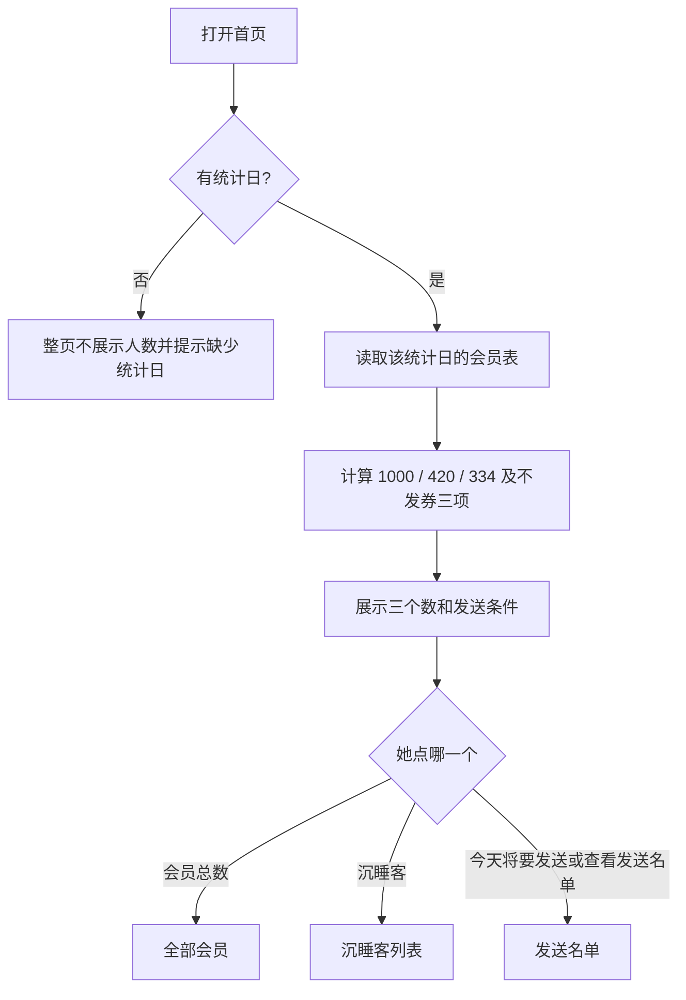
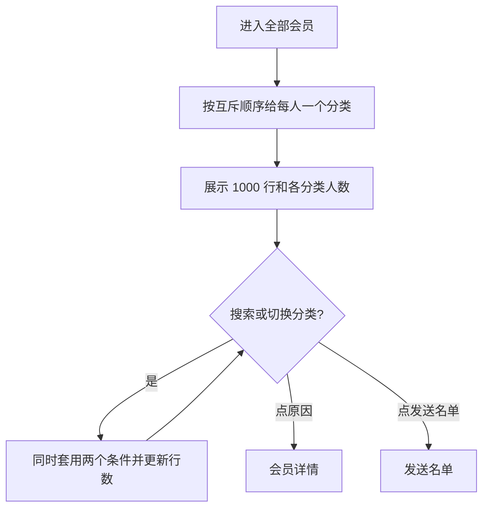
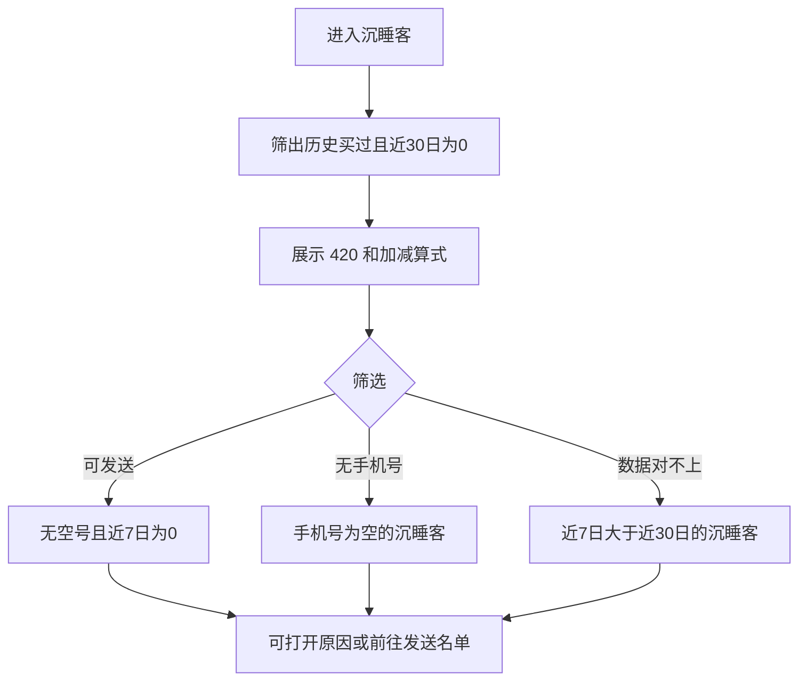
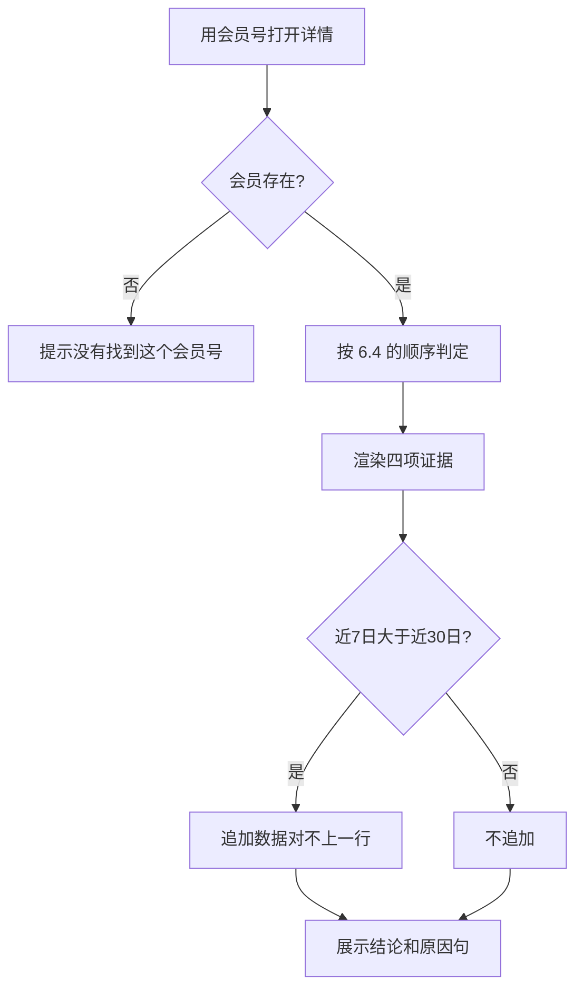
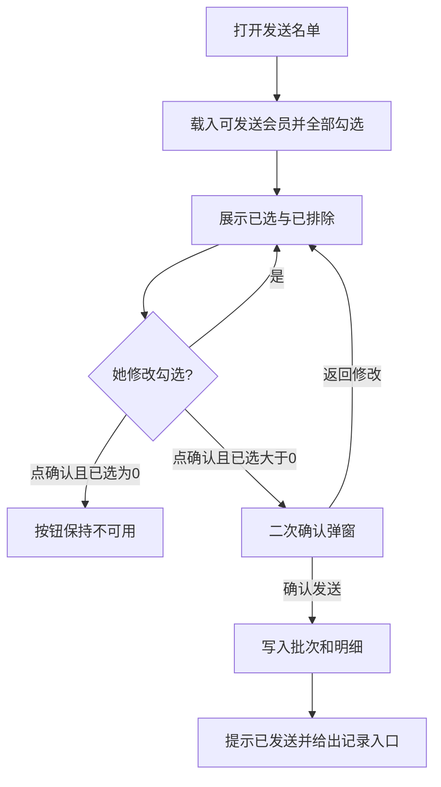
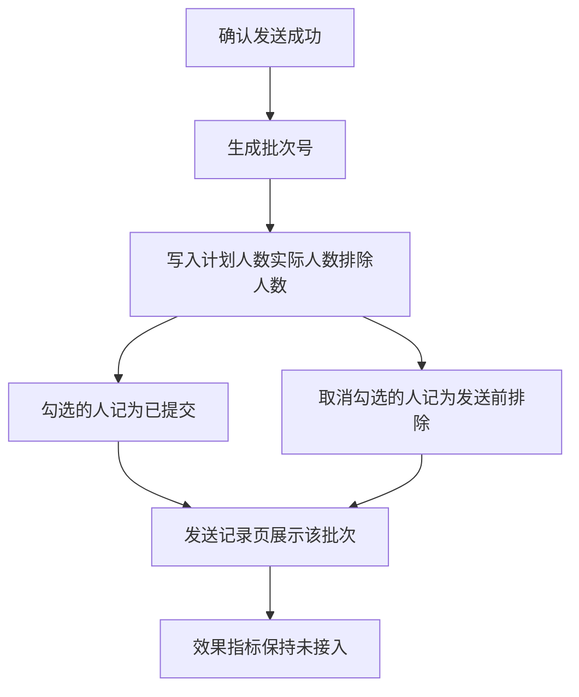

# 邻里券 产品需求文档

> 虚构说明：「邻里购」社区超市、1,000 名会员、全部手机号与购买记录，均为产品练习用的样例数据，不对应任何真实的人或企业。本文描述的是这套样例上已经跑通的产品，统计日固定为 2026-10-20。

## 1. 文档信息

| 版本号 | 创建日期 | 负责人 | 状态 | 统计日 |
| --- | --- | --- | --- | --- |
| V1.0 | 2026-10-22 | 郑深源 | 原型已验收，待接入短信网关 | 2026-10-20 |

本文是完整 PRD。数字以清洗后会员表 `data/清洗后/all_members_清洗ver_1.0.csv` 为准，Excel 筛选、`sql/metrics.sql`、页面脚本三处结果相同。

## 2. 修订历史

| 版本   | 修订内容                                     | 修订时间       | 修订人 |
| ---- | ---------------------------------------- | ---------- | --- |
| V1.0 | 依据项目已有产品说明、使用流程、取舍、页面数字、与可运行原型，整理为完整 PRD | 2026-10-22 | 郑深源 |

## 3. 名词解释

| 术语        | 解释                                                                  |
| --------- | ------------------------------------------------------------------- |
| 邻里券       | 给邻里购会员运营用的发券工具。每周五打开发券页，看清该请回谁，再确认发送。                               |
| 王姐        | 本店唯一的会员运营。顶栏和发送记录里的操作人写这个名字。本期不做登录。                                 |
| 统计日       | 这批会员数据截到哪一天。样例是 2026-10-20（周五）。近 30 日、近 7 日都从这一天往前推。日期由数据侧给出，产品只展示。 |
| 已支付订单     | 购买次数只计已支付且未取消的订单。购买次数 = 下单数 − 取消数。                                  |
| 常购客       | 近 30 日购买次数 ≥ 2。标签口径，与其他标签可以同时成立。                                    |
| 沉睡客       | 历史买过，且近 30 日购买次数 = 0。这是要请回来的人。首页的 420 用的是这个口径。                      |
| 本周到店客     | 近 7 日购买次数 ≥ 1。这周已经来过。标签口径与会员列表里的互斥分类不是同一个数，见 6.3。                   |
| 发送名单      | 同时满足：沉睡客、有手机号、近 7 日购买次数 = 0。样例为 334 人。                              |
| 数据对不上     | 近 7 日购买次数 > 近 30 日购买次数。7 天包含在 30 天里，业务上不可能成立。保留该会员，不进发送名单。          |
| 低频未到店     | 互斥分类之一：近 30 日购买次数 = 1，且近 7 日 = 0。三个标签都不覆盖，本期不发券。                    |
| 满 99 减 20 | 本期唯一的券。渠道只有短信。面额、门槛、渠道都不可在页面上改。                                     |
| 批次        | 一次确认发送产生的一条记录。样例批次号 `B20261020`。                                    |
| 从未购买      | 没有购买记录的客人，即历史购买记录为“否”的客人                                            |

## 4. 产品概述

### 4.1 产品背景

#### 市场现状

社区超市的会员运营，公开产品已经分成两头。一头是收银和会员系统里的「沉睡会员唤醒」：按「多少天没来」筛一批人，批量推一张唤醒券。思迅天店的公开说明把「30 天以上未消费」做成可筛选人群，再批量推送唤醒券，用来替换不分对象的群发。有赞的会员与社群产品则把沉默会员打标签、放进营销画布，用企微、订阅消息和券去催复购。另一头是客户数据平台。神策公开的用户标签与人群能力，要求标签有书面定义，再把人收成可触达的人群；触达通道包括短信。华润数科公开的客户数据平台，把会员标签、人群圈选、节日短信和可视化经营分析放在同一套平台里，服务的是多业态、大体量会员。

这些能力解决的是「公司里有分析师或运营团队，可以配置标签、画布和渠道」。单店社区超市的周五不是这个形态。店里 1,000 名会员，而会员运营只有王姐一个人。店长认识这些会员，会指着一个人问为什么她收到了券、邻居没有。在这样的背景之下，王姐需要的是简单可上手的快速筛选决策工具，而不是一个复杂宏大的“用户画像分析及预测系统”

#### 问题与机会

王姐每周五要发一批「满 99 减 20」，把好久没来、但以前买过的人请回店里。她现在的系统只有一个「全体群发」按钮，于是三件事同时发生：

1. 1,000 人一起发。近 30 日已经买过 2 次及以上的常购客也在里面，券打在本来就会发生的消费上。
2. 系统里看不到「这周谁刚来过」。近 7 日已经进店的人再收一张满减，只是让出毛利。
3. 发完没有一份可逐行核对的名单。店长问这一批发给了谁，她只能答「都发了」。

机会不在再做一个营销中台。机会是把发券前的那一段做成她周五能独立做完的决定：这一期发给谁，以及每一个人为什么发、为什么不发。

#### 为什么是现在

券的成本按人头发生。名单从 1,000 收到 334，少发的是常购客、本周已经到店的人、没有手机号的人，以及两个次数互相矛盾的人。这一刀不依赖模型，用三条写死的规则就能做完。规则写得出来，同一张清洗后的表可以用 Excel、SQL 和页面算出同一个 334。做不到这一点，后面的送达率和 7 日回店率都没有分母。

短信是她这期唯一发得出去的通道。没有手机号的人如果混进「已发送」，下周按名单复盘时，分母是错的。所以联系不上的人要出现在沉睡客统计里，但不能进入发送名单。

#### 我们的优势

规则短到可以念给店长听。点开任何一个会员，四项证据逐条给出「是 / 否」，下面有一句人话结论。发送对象是一份名单，不是一个点进去看不见人的人群包：可以逐行看、逐行取消勾选、逐行追溯。首页打开就是「今天将要发送」的人数，她不用自己做筛选。

这个优势成立的前提是口径已经在数据侧写死。在测试样例里，原始导出 1,060 行，会员号统一格式并去重后是 1,000 人；沉睡客 420；发送名单 334。三个数能被别人重算，产品才算交付。

### 4.2 产品目标

用户目标：周五约 10 分钟内，王姐决定这一期短信发给谁，确认后发出去。对名单内任意一人，她能说出为什么发；对名单外任意一人，她能说出为什么不发。

业务目标，本期用过程指标约束，不预设召回率目标值：

| 目标 | 本期怎么算达到 |
| --- | --- |
| 发之前能看清对象 | 首页同时给出会员总数 1,000、沉睡客 420、今天将要发送 334，并写明三条发送条件 |
| 券不发给不该发的人 | 发送名单中，近 7 日购买次数全部为 0，手机号全部非空，且不包含数据对不上的记录 |
| 发完说得清 | 每次确认生成一条批次。批次人数等于确认时勾选的人数，明细可按会员号追溯 |
| 数字经得起复核 | 同一张清洗表上，Excel、`sql/metrics.sql`、页面三个数一致 |

上线后才看的两个结果指标见第 10 节。本期没有严格对照组，不把 7 日回店率写成承诺。

### 4.3 目标用户

| 项     | 内容                                          |
| ----- | ------------------------------------------- |
| 用户    | 邻里购会员运营王姐，1 人                               |
| 决策相关人 | 店长。他不操作系统，但会追问某一个会员为什么收到券                   |
| 频次    | 每周五 1 次                                     |
| 时长    | 约 10 分钟                                     |
| 场景    | 周五 15:00，打开邻里券，核对统计日，看名单，必要时去掉她知道不该发的人，确认发送 |
| 成功标准  | 她离开页面时，手里有一份已提交的名单，并且能用页面上的原句向店长解释任意一个人     |

数据侧是依赖方，不是使用者。他们按统计日交出会员表。王姐不在这个产品里改口径、不建标签、不看趋势图。

### 4.4 用户痛点

| 痛点                | 她现在怎么做             | 结果                   |
| ----------------- | ------------------ | -------------------- |
| 分不出谁好久没来          | 只有全体群发             | 常购客和沉睡客收到同一张券        |
| 分不出这周谁刚来过         | 系统没有「近 7 日次数」可看的地方 | 券发给了这周已经进店的人         |
| 发完对不上人            | 没有批次和明细            | 店长追问时只能回答「都发了」       |
| 联系不上的人被算成已触达      | 群发按钮不区分有没有手机号      | 复盘时以为券没效果，实际是有人没收到短信 |
| 规则说不清             | 没有逐条证据             | 店长指着一个会员号，她无法当场回答    |
| 会员号没归一，同一个人被当成两个人 | 只有全体群发             | 同一个用户可能收到两张一样的券      |

样例上这五件事分别对应可见的数：常购客互斥分类 300 人；近 7 日买过的人 398 人；发送记录在确认后才存在；沉睡客里 56 人没有手机号；会员详情用四项证据回答「为什么」。

### 4.5 主要功能

本期按她周五的操作顺序，做六件事：

1. 首页给出三个数、一条发送条件，以及本期明确不发的人群计数。
2. 全部会员按互斥分类筛选、按会员号或手机号搜索，任一人可打开原因。
3. 沉睡客明细把 420 拆到 334，并标出无手机号和数据对不上。
4. 会员详情列出四项证据和一句结论。
5. 发送名单默认全选，可单人取消、可全选、可取消全选，计数即时变化，二次确认后发送。
6. 发送记录留下批次、计划人数、实际人数、发送前排除人数和每人一条明细。

`原型/funnel.html` 只给看作品的人核对三个数，不进入产品导航，不作为功能交付。

### 4.6 竞品分析

对照的是她周五会碰到的三类做法，不是把邻里券做成其中任何一类。

#### 现状：全体群发

这是她现在的按钮，也是本产品要替换的动作。一次发给全部会员。没有沉睡、本周到店、手机号三种区分，发完没有可核对的明细。优点是她已经会用，点一下就结束。代价是常客也收到券，事后无法解释发给了谁。

#### 会员营销系统里的沉睡唤醒

思迅天店公开的复购能力，是按消费数据筛出 30 天以上未消费的会员，再批量推唤醒券，并同时提供积分、生日福利和老带新。有赞公开的社群与会员能力，是按消费金额、频次、品类打标签，把沉默会员放进自动触达。这类产品覆盖拉新、复购、沉睡、生日多条链路。对王姐的问题是：周五她只有一个决定。首页如果同时出现多种券和多个按钮，她会回到熟悉的全体群发。

#### 客户数据平台

神策公开材料把标签写成可落地的定义，再用人群做短信等通道的触达；个性化旅程面向的是可配置的策略和全流程记录。项目借鉴了其中两点：标签必须有书面定义（「近 30 日购买 ≥ 2 次」，而不是「活跃用户」）；发送对象要能落到一份可逐行查看的名单。没有借鉴他们的界面和功能范围。

华润数科公开的客户数据平台包含会员标签与画像、按标签圈定人群、节日营销短信，以及销售与费用的可视化报告。公开页面写的是多业态会员和经营分析。邻里券只留下其中「发券前先看清人群」这一段，不做 BI。

#### 对比

| 维度      | 全体群发   | 会员系统的沉睡唤醒     | 神策 / 华润数科一类 CDP   | 邻里券                    |
| ------- | ------ | ------------- | ----------------- | ---------------------- |
| 周五要做的决定 | 发或不发   | 选券种、选人群、选通道   | 配置标签与策略           | 只决定这 334 人里还要去掉谁       |
| 能否对单人解释 | 不能     | 取决于后台是否把规则写到人 | 人群包，店长问到某一个人时仍要再拆 | 四项证据加一句结论              |
| 本周已到店   | 照样发    | 可配置，不是默认写死    | 可配置               | 近 7 日 ≥ 1 的人不进名单       |
| 无手机号    | 常被算进发送 | 视通道而定         | 多通道可绕过短信          | 留在沉睡客 420 里，不进 334发券名单 |
| 趋势与看板   | 无      | 常带会员动态        | 经营分析是产品的一部分       | 本期不做                   |
| 模型选人    | 无      | 部分产品提供自动化     | 公开能力含人群与策略引擎      | 不做。选人由硬性口径制定           |

可借鉴的是书面标签和可逐行追溯的名单。不借鉴的是多券种、营销画布、推荐模型和 BI。那些能力回答的是后续功能叠加更新的问题。

## 5. 范围

### 5.1 本期做

1. 展示数据侧给出的统计日。统计日缺失时，不展示任何人数。
2. 用清洗后的会员表计算三个首页数字和六类互斥分类。
3. 生成发送名单，允许在确认前勾选或取消。
4. 任一会员打开原因页，四项证据与原始字段一致。
5. 二次确认后提交短信发送，并生成批次与明细。
6. 在沉睡客页暴露「无手机号」人数，供她去前台补手机号。补录本身不在本期。

### 5.2 本期不做

| 不做 | 原因 | 放弃的代价 |
| --- | --- | --- |
| 新客首单券、生日券、满额加价券、拼团、积分兑换 | 周五只有「这批召回券发给谁」一件事。新客还没进过店；生日按日期触发，不必在周五决定；满额加价提高的是客单价，和「请人回来」方向相反 | 帮不了大促，也帮不了拉新 |
| 复购概率预测、个性化折扣、模型自动选人、A/B 分组 | 店长会问为什么这个人收到、邻居没有。模型给不出她能当场复述的理由。规则写死，证据可以逐条打勾 | 同样一批人，模型可能多唤回几个。用不起来的准确率是 0 |
| 给近 7 日已经到店的人发券 | 券用来请人回来。这周已经来过，再发满 99 减 20，只是给即将发生的消费打折 | 这周偶然来过的目标客要等到下周。下周若仍满足条件，会重新进名单 |
| 企业微信、电话外呼、到店核销、App 弹窗 | 本期通道只有短信。发不出去的人不能记为发送成功 | 56 名无手机号的沉睡客这期联系不上 |
| BI、回购趋势、运营看板 | 她要的是周五的名单，不是三个月的曲线。看板另做，不堆进发券页 | 沉睡客从 420 涨到 600，她在本产品里看不到趋势 |
| 核销追踪、回流归因 | 依赖短信回执和 POS 订单回流 | 本期记录只有「已提交」，没有「已送达」，也没有 7 日回店 |
| 自动发送、定时发送 | 发错撤不回，必须由她确认 | 她不在店里时，这一期不会自己发出去 |
| 登录、权限、多门店 | 使用者只有王姐一人 | 换人操作时，记录里的操作人仍是王姐，直到下一期接入账号 |
| 在页面上修改券面额、门槛或文案 | 本期券固定为满 99 减 20 | 临时换券要改配置后重新发版，不能在周五页面上改 |

## 6. 数据接口与业务规则

规则要能直接写成 SQL。实现以 `sql/metrics.sql`（三个数）和 `sql/member_list.sql`（到人的分类与是否可发）为准。

### 6.1 上游给什么

数据侧每日跑批，按统计日切好窗口后交付。产品不根据订单明细重算「哪一天落在 30 天里」。

原始导出（样例 `data/raw/会员导出_2026-10-20.csv`，1,060 行）的列：

| 字段 | 说明 |
| --- | --- |
| 会员编号 | 同一人可能写成 `M0001`、`m0001`、带空格或带横线 |
| 历史是否购买 | 样例中有多种写法，需归一 |
| 手机号码 | 可为空，也可能写成「无」「NULL」「-」，或带空格、横线、`+86` |
| 近7日下单数 / 近7日取消数 | 可空，可带「次」、全角数字或小数写法 |
| 近30日下单数 / 近30日取消数 | 同上 |

产品读取的会员表（样例清洗结果 1,000 行）字段：

| 字段 | 类型 | 说明 |
| --- | --- | --- |
| 会员号 | string | 唯一。归一规则见 6.2 |
| 手机号 | string | 可为空字符串。页面展示为前 3 位 + `****` + 后 4 位 |
| 近30日购买次数 | int | ≥ 0。已支付订单，不含取消 |
| 近7日购买次数 | int | ≥ 0。同上 |
| 历史是否买过 | bool | 是 / 否 |
| 统计日 | date | 整批一个值。样例 `2026-10-20` |

### 6.2 责任边界与清洗口径

| 事项 | 负责方 | 规则 |
| --- | --- | --- |
| 切 30 日 / 7 日窗口、给出统计日 | 数据侧 | 产品只展示统计日，不自行推日期 |
| 统计日缺失 | 产品 | 拒绝进入发券页，提示「没有统计日，名单不能生成」 |
| 会员号归一 | 数据侧交付前完成；产品若收到未归一的导出，按同一规则处理 | 去首尾空格，去掉中间空格和 `-`，再转大写。同一归一编号多行时保留首条，其余丢弃。样例 1,060 行得到 1,000 个会员 |
| 手机号归一 | 同上 | 去空格和 `-`。值为空、`无`、`NULL`（不区分大小写）、`-`，记为空。以 `+86` 开头时取其后 11 位。空号保留在会员表里，不删行 |
| 次数字段 | 同上 | 空值记 0。去掉「次」和首尾空格，全角数字转半角后取整数。购买次数 = 下单数 − 取消数。结果必须 ≥ 0 |
| 历史是否买过 | 同上 | `是`、`Y`、`YES`、`1`、`TRUE`（忽略大小写与首尾空格）记为是，其余记为否 |
| 只给「下单数 + 取消数」、没给购买次数 | 产品 | 先做减法，再进入 6.3 |
| 窗口切错但两个次数自洽 | 数据侧对账 | 产品无法从这两个数里发现窗口错误 |

清洗在副本上完成，原始导出保留，便于倒查。

### 6.3 标签、发送名单、互斥分类

三个标签不互斥，用于首页解释和「本期不发券」：

| 标签 | 判定 | 样例人数 | 和发券的关系 |
| --- | --- | --- | --- |
| 常购客 | 近 30 日购买次数 ≥ 2 | 300 | 首页展示，不发券 |
| 沉睡客 | 历史买过 = 是，且近 30 日购买次数 = 0 | 420 | 请回来的候选人。含数据对不上的 40 人 |
| 本周到店客 | 近 7 日购买次数 ≥ 1 | 398 | 这周已经来过，不发券 |

398 的构成是：互斥分类中的常购客里近 7 日 ≥ 1 的 238 人，加上互斥分类「本周到店客」120 人，加上「数据对不上」40 人。首页这个 398 和会员列表筛选里的 120 都是对的，口径不同，不能改成同一个数。

发送名单同时满足下面四条，样例 334 人：

1. 历史买过 = 是
2. 近 30 日购买次数 = 0
3. 近 7 日购买次数 = 0
4. 手机号不为空

数据对不上的记录近 7 日次数至少为 1，会被第 3 条挡住，不必再写一条「并且无矛盾」。两条写法在本数据上结果相同。

从 420 到 334 的加减必须展示在沉睡客页和发送名单页，否则她会问少掉的人在哪：

```text
420 − 56（无手机号）− 40（数据对不上）+ 10（两条件都占，避免减两次）= 334
```

互斥分类按顺序判定，一人只落一类。顺序不能换。先判常购客，会把「近 30 日 ≥ 2 且近 7 日 ≥ 1」的人从本周到店里拿走，这是当前顺序的既定结果；若把本周到店放到常购客之前，120 和 300 都会变。

| 顺序 | 分类 | 条件 | 样例人数 |
| --- | --- | --- | --- |
| 1 | 数据对不上 | 近 7 日 > 近 30 日 | 40 |
| 2 | 从未购买 | 历史买过 = 否 | 80 |
| 3 | 常购客 | 近 30 日 ≥ 2 | 300 |
| 4 | 本周到店客 | 近 7 日 ≥ 1 | 120 |
| 5 | 低频未到店 | 近 30 日 = 1 且近 7 日 = 0 | 80 |
| 6 | 沉睡客 | 其余 | 380 |

六类之和 = 1,000。首页沉睡客 420 = 互斥分类沉睡客 380 + 数据对不上 40。本样例中，40 条矛盾记录的近 30 日次数都是 0，所以它们全部落在标签「沉睡客」里，又被互斥分类第 1 步单独挑出。

### 6.4 原因文案

会员详情先按互斥分类决定结论，再补手机号。文案使用下面的句子，人数用该会员自己的次数填入。

| 命中 | 分类标签 | 是否进入发送名单 | 结论 |
| --- | --- | --- | --- |
| 近 7 日 > 近 30 日 | 数据对不上 | 否 | 近 7 日买了 {近7日} 次，近 30 日却只有 {近30日} 次。7 天包含在 30 天里，这两个数不可能同时成立，所以先不发，等数据修好。 |
| 历史买过 = 否 | 从未购买 | 否 | 没有购买记录，不属于沉睡客。沉睡客的前提是以前至少买过 1 次。 |
| 近 30 日 ≥ 2 | 常购客 | 否 | 近 30 日买了 {近30日} 次，是常购客。常购客只在首页展示，本期不发券。 |
| 近 7 日 ≥ 1 | 本周到店客 | 否 | 近 7 日买过 {近7日} 次。券是请人回来的，不发给这周已经来过的人。 |
| 近 30 日 = 1 | 低频未到店 | 否 | 近 30 日只买过 1 次，不属于三个标签中的任何一个。本期不发送。 |
| 以上都不中，且手机号为空 | 无手机号 | 否 | 是沉睡客，但档案里没有手机号，短信发不出去。她算在 420 里，但不进名单。 |
| 以上都不中，且有手机号 | 沉睡客 | 是 | 以前买过，近 30 日一次没买，这周也没来，有手机号，所以今天发给她。 |

沉睡客列表的短原因：

| 条件 | 短原因 |
| --- | --- |
| 无手机号且数据对不上 | 没有手机号，而且两个次数对不上 |
| 仅无手机号 | 档案里没有手机号，短信发不出去 |
| 仅数据对不上 | 近 7 日次数大于近 30 日，数据对不上 |
| 可发送 | — |

详情页固定展示四行证据。每一行有字段值，以及是否满足「能发」：

| 证据 | 满足（是） | 不满足（否） |
| --- | --- | --- |
| 以前买过 | 有购买记录 | 没有购买记录 |
| 近 30 日购买次数 | 次数 = 0 时标「沉睡客」 | ≥ 2 标「常购客」；= 1 标「低频」 |
| 近 7 日购买次数 | = 0 时标「这周没来」 | ≥ 1 标「本周到店客」 |
| 手机号 | 有号时标「能发短信」 | 空时标「发不出去」 |

若近 7 日 > 近 30 日，追加一行：「近 7 日 ≤ 近 30 日」不成立，标「数据对不上」。

进入发送名单时，页头结论为「在发送名单里，今天会收到券」，副文案「四条证据都成立」。否则为「不在发送名单里，今天不会收到券」，副文案「有一条不成立，原因见下」。

### 6.5 样例会员（验收夹具）

| 会员号 | 历史买过 | 近 30 日 | 近 7 日 | 手机号 | 结论 |
| --- | --- | --- | --- | --- | --- |
| M0632 | 是 | 0 | 0 | 188****5834 | 发 |
| M0155 | 是 | 0 | 0 | 空 | 不发，无手机号 |
| M0034 | 是 | 0 | 1 | 137****7228 | 不发，数据对不上 |
| M0969 | 是 | 0 | 1 | 空 | 不发，数据对不上且无手机号 |
| M0867 | 否 | 0 | 0 | 135****4595 | 不发，从未购买 |

### 6.6 发送状态

```text
名单生成（草稿，默认勾选全部可发送会员）
    → 勾选 / 取消勾选（计数即时变化，可撤回）
    → 二次确认（弹窗写明人数与券名）
    → 已提交（生成批次，不可在本产品内撤回）
    → 已送达、7 日回店（下一期，依赖短信回执与订单回流）
```

本期明细状态只有「已提交」。不展示「已送达」。

批次字段：

| 字段 | 规则 |
| --- | --- |
| 批次号 | `B` + 统计日 `YYYYMMDD`。同一统计日第 2 次及以后加 `-02`、`-03`。样例第一次为 `B20261020` |
| 时间 | 确认发送的本地时间，精确到分钟 |
| 券 | 满 99 减 20 |
| 渠道 | 短信 |
| 操作人 | 王姐 |
| 计划发送 | 打开名单时的可发送人数。样例 334 |
| 实际发送 | 确认时仍勾选的人数 |
| 发送前排除 | 计划发送 − 实际发送。被排除的会员号记在该批次下，状态为「发送前排除」 |
| 效果指标 | 本期固定展示「未接入」 |

短信网关未接入时，确认动作在产品内把批次记为已提交，并提示「已向 N 人发送「满 99 减 20」」。不伪造送达回执。

## 7. 功能需求

信息架构与原型一致：

| 页面 | 原型文件 | 导航 | 作用 |
| --- | --- | --- | --- |
| 发券首页 | `原型/index.html` | 发券 | 三个数、发送条件、本期不发、标签定义 |
| 全部会员 | `原型/all.html` | 会员 | 1,000 人，搜索与互斥分类 |
| 沉睡客 | `原型/sleepers.html` | 沉睡客 | 420 人，以及 420 到 334 的拆解 |
| 会员详情 | `原型/member.html?id=` | 从「原因」进入 | 四项证据与结论 |
| 发送名单 | `原型/confirm.html` | 首页主按钮、各页「发送名单」 | 勾选与确认 |
| 发送记录 | `原型/records.html` | 发送记录 | 批次与明细 |

顶栏每一页都显示产品名「邻里券」、上述四个导航、统计日、操作人「王姐」。

### 7.1 发券首页

#### 功能概述

周五打开产品的第一屏。她不需要自己筛选，就能看见今天将要发送的人数，以及这个人数用哪三条规则算出来。

#### 用户场景

- 用户：王姐
- 背景：周五 15:00，店长要求把召回券发出去
- 目标：确认统计日是这一期，并知道今天默认发给多少人
- 行为：
  1. 打开首页，先看右上角统计日是不是 2026-10-20
  2. 读「今天将要发送」
  3. 用下方一句「沉睡客 + 有手机号 + 近 7 日没来过」向自己核对
  4. 需要解释时，点三个数字之一进入对应列表
- 结果：她知道默认名单是 334 人，并且知道常购客、本周已到店、无手机号为什么不在里面
- 痛点：以前这三个数不在任何一页上，她只能点全体群发

#### 页面内容

页头标题「本周发券」，副标题「满 99 减 20 · 短信 · 统计日 {统计日}」。右侧两个按钮：「全部会员」「查看发送名单」。

三个可点击数字：

| 数字 | 样例 | 说明文案 | 点击去向 |
| --- | --- | --- | --- |
| 会员总数 | 1,000 | 全部会员记录 | 全部会员 |
| 沉睡客 | 420 | 历史买过，近 30 日 0 次 | 沉睡客 |
| 今天将要发送 | 334 | 能发、该发的人 | 发送名单 |

数字使用千分位。第三个数字用强调样式。

发送条件一行，写在三个数字下面：

```text
发送条件  沉睡客 ＋ 有手机号 ＋ 近 7 日没来过 ＝ 334 人
```

「本期不发券」三行，使用标签口径，不使用互斥分类：

| 行 | 样例 | 文案 |
| --- | --- | --- |
| 常购客 | 300 | 近 30 日买过 2 次及以上 |
| 本周到店客 | 398 | 近 7 日买过 |
| 无手机号 | 56 | 算在 420 里，不进名单 |

「标签定义」三行，文案固定：

| 标签 | 定义 | 旁注 |
| --- | --- | --- |
| 常购客 | 近 30 日购买 ≥ 2 次 | 只在首页展示，本期不发券 |
| 沉睡客 | 以前买过 ≥ 1 次，近 30 日 0 次 | 本期要请回来的人 |
| 本周到店客 | 近 7 日购买 ≥ 1 次 | 这周已经来过，不发券 |

定义下方三条说明：购买按已支付订单计，取消的不算；所有次数从统计日往前推；近 7 日次数大于近 30 日次数的记录视为数据对不上，不进名单。

#### 功能流程



#### 前置条件

- 已有一份与统计日绑定的会员表
- 会员号在表内唯一

#### 后置条件

- 页面上的 334 与发送名单行数一致
- 三个数字全部由当前会员表计算，不把样例数字写死在页面里

#### 异常场景

| 异常情况 | 触发条件 | 处理方式 | 用户提示 |
| --- | --- | --- | --- |
| 没有统计日 | 批次未带日期 | 不渲染人数，主按钮不可用 | 没有统计日，名单不能生成 |
| 会员表为空 | 0 行 | 三个数显示 0，仍可打开空列表 | 这一期没有会员记录 |
| 会员表加载失败 | 文件或接口失败 | 不显示上一次的旧人数 | 会员表没有载入，请联系数据侧 |
| 购买次数为负 | 取消数大于下单数且上游未修 | 该行不进发送名单，会员详情可见 | 购买次数为负，先不发 |
| 人数与 SQL 不一致 | 验收阶段比对 | 不得上线 | 不向王姐展示第二套数 |

### 7.2 全部会员

#### 功能概述

1,000 名会员的总表。用来回答「这个人不在今天的名单里，她属于哪一类」。

#### 用户场景

- 用户：王姐
- 背景：店长提到一个会员号，她要在发券前确认这个人落在哪一类
- 目标：用会员号找到人，或按分类看某一类有多少人
- 行为：
  1. 从首页「会员总数」或导航「会员」进入
  2. 在搜索框输入会员号或手机号里还看得见的数字
  3. 或点分类切换：全部、今天发券、常购客、沉睡客、本周到店、低频未到店、从未购买、数据对不上
  4. 点该行「原因」进入详情
- 结果：列表只剩符合条件的行，表头人数与筛选结果一致
- 痛点：以前无法按「为什么不发」把人分开

#### 页面内容

副标题「共 1,000 人 · 本期发券 334 人」。按钮：「只看沉睡客」「发送名单」。

搜索框占位符：「搜会员号或手机号」。搜索不区分大小写。会员号按包含匹配。手机号按页面上未打码的数字匹配（前 3 位与后 4 位）。

分类切换的人数使用 6.3 的互斥分类，外加「今天发券 334」。样例：全部 1000、今天发券 334、常购客 300、沉睡客 380、本周到店 120、低频未到店 80、从未购买 80、数据对不上 40。

表列：会员号、手机号、近 30 日、近 7 日、历史买过、分类、今天发券、原因。手机号为空时显示「空」。今天发券列只对发送名单中的人打勾，其余为「—」。

表下固定说明：分类按规则顺序判定，一人只落一类。「沉睡客 380」加上「数据对不上 40」，等于首页的 420。

筛选与搜索同时生效。切换分类或输入搜索时，列表与「显示 N 人」在同一次操作内更新。

#### 功能流程



#### 前置条件

首页所用的同一份会员表已载入。

#### 后置条件

各分类人数之和为会员总数。今天发券的人数等于发送名单人数。

#### 异常场景

| 异常情况 | 触发条件 | 处理方式 | 用户提示 |
| --- | --- | --- | --- |
| 搜索无结果 | 没有会员号或手机号片段命中 | 表体为空，人数为 0 | 显示 0 人 |
| 手机号为空 | 归一后为空字符串 | 单元格写「空」，仍可按会员号搜到 | 空 |
| 一人同时像两类 | 例如近 30 日 ≥ 2 且近 7 日 ≥ 1 | 只显示顺序靠前的一类 | 分类列只有一个标签 |

### 7.3 沉睡客明细

#### 功能概述

只看标签口径的 420 名沉睡客，并把少掉的 86 人拆开。无手机号的人留在这里，方便她下次见到客人时补号。

#### 用户场景

- 用户：王姐
- 背景：她想确认「不发」的人是联系不上，还是数据坏了
- 目标：把 56 个无手机号的人认出来，交给前台补录
- 行为：
  1. 从首页「沉睡客」进入
  2. 看顶部算式 420 − 56 − 40 + 10 = 334
  3. 点「无手机号」只看这 56 人
  4. 点「原因」看某一个为什么不发
- 结果：她能指出哪些人要补手机号，哪些人要等数据侧修复
- 痛点：这两类人以前混在群发名单里，或者干脆看不见

#### 页面内容

标题「沉睡客」。副标题「共 420 人 · 本期可发送 334 人」。

顶部算式五项：沉睡客 420、− 无手机号 56、− 数据对不上 40、+ 两者都占 10、= 可发送 334。

筛选：全部 420、可发送 334、无手机号 56、数据对不上 40。「无手机号」与「数据对不上」允许交叉，10 个两者都占的人在两个筛选里都会出现。

表列：会员号、手机号、近 30 日、近 7 日、结论（可发送 / 不发）、短原因、原因链接。

表下说明当前显示行数，并写明只有可发送的 334 人进入发送名单。

#### 功能流程



#### 前置条件

会员表已按 6.3 打上沉睡客标签。

#### 后置条件

可发送行数等于首页「今天将要发送」。算式在整数上闭合。

#### 异常场景

| 异常情况 | 触发条件 | 处理方式 | 用户提示 |
| --- | --- | --- | --- |
| 无手机号且数据对不上 | 同一人两条都中 | 在两个筛选中都出现，算式用 +10 加回 | 没有手机号，而且两个次数对不上 |
| 沉睡客为 0 | 本期没有人满足标签 | 算式各项为 0，表为空 | 共 0 人 |
| 她从这里期望直接发券 | 当前行是不发 | 不提供单行发送。发送只在发送名单发生 | 不发 |

### 7.4 会员详情

#### 功能概述

对一个会员号给出发或不发的证据。这是她回答店长的那一页。

#### 用户场景

- 用户：王姐
- 背景：店长问为什么给某人发、不给另一个人发
- 目标：用页面上的句子直接回答，不另做解释
- 行为：
  1. 在任一列表点「原因」
  2. 看页头结论是「在发送名单里」还是「不在发送名单里」
  3. 从上到下核对四项证据的是 / 否
  4. 读底部那一句原因
- 结果：她能复述原因，且复述与字段一致
- 痛点：以前只能说「系统发的」或「都发了」

#### 页面内容

标题为会员号，旁边是 6.4 的分类标签。副标题「会员详情 · 统计日 {统计日}」。

结论区两种样式：可发送为肯定样式，不可发送为否定样式。证据区四行，必要时加「数据对不上」第五行。底部是 6.4 的整句原因。

页底保留发送条件原文：「沉睡客 ＋ 有手机号 ＋ 近 7 日没来过」，并提供返回发送名单的按钮。详情页不能改勾选，避免她在解释某一个人时改动整批名单。

#### 功能流程



#### 前置条件

从列表带入会员号，或 URL 带 `id`。

#### 后置条件

证据行中的次数、是否买过、手机号与会员表该行一致。结论与 6.3 的发送条件一致。

#### 异常场景

| 异常情况 | 触发条件 | 处理方式 | 用户提示 |
| --- | --- | --- | --- |
| 会员号不存在 | `id` 为空或表中没有 | 不展示伪造证据，不报技术错误页 | 没有找到这个会员号 |
| 数据对不上同时无手机号 | 如 M0969 | 分类优先显示「数据对不上」。短原因在沉睡客列表里写两条都占 | 见 6.4 第一句 |
| 低频未到店 | 近 30 日 = 1 且近 7 日 = 0 | 明确写本期不发送，不归进沉睡客 | 近 30 日只买过 1 次，不属于三个标签中的任何一个。本期不发送。 |

### 7.5 发送名单与确认发送

#### 功能概述

334 人的可执行名单。默认全选。她可以去掉明知不该发的人，例如已经搬走的会员。确认前可以改回来。确认后立即提交，不能在产品内撤回。

#### 用户场景

- 用户：王姐
- 背景：名单已经生成。店长上周说过某位会员要搬走，以后不会再来
- 目标：从 334 里去掉这个人，然后发出其余的券
- 行为：
  1. 打开发送名单，看到默认已选 334、已排除 0
  2. 取消该会员的勾选，底部变为已选 333、已排除 1
  3. 点「确认发送「满 99 减 20」」
  4. 在弹窗核对「向 333 人发送满 99 减 20 券」
  5. 点确认
- 结果：提示已向 333 人发送，生成一条批次，按钮变为「查看发送记录」
- 痛点：以前不能从群发里摘掉一个人，也不能在发送前看到人数变化

#### 页面内容

标题「发送名单」。副标题「满 99 减 20 · 短信 · 共 334 人」。这里的 334 是计划人数，不随取消勾选变化。

顶部保留同一条算式：420 − 56 − 40 + 10 = 334。提供「全选」「取消全选」。链接「全部沉睡客 420」回到沉睡客页。

表列：勾选框、会员号、手机号、近 30 日、近 7 日、状态（固定「沉睡客」）、原因。默认每行勾选。

底部：已选 N 人、已排除 M 人、文案「确认后立即发送，不可撤回」、按钮「确认发送「满 99 减 20」」。N + M = 计划人数。N 为 0 时按钮不可用。

二次确认弹窗文案：

```text
向 {N} 人发送满 99 减 20 券。确认后不可撤回。
```

按钮为「确认发送」和「返回修改」。返回修改不改变当前勾选。

确认成功后，原按钮替换为「查看发送记录」，并出现提示「已向 {N} 人发送「满 99 减 20」」。提示约 3 秒后收起，记录仍保留。

本页只包含可发送会员。无手机号、数据对不上、常购客、本周到店、从未购买、低频未到店都不能被勾进来。

#### 功能流程



#### 前置条件

- 统计日存在
- 发送名单已按 6.3 生成
- 她尚未在本页完成这一次确认。确认后本页勾选冻结，再发要等下一次打开并产生新批次

#### 后置条件

- 批次的实际发送人数等于弹窗里的 N
- 被取消勾选的会员出现在该批次的排除明细，不出现在发送明细
- 短信侧若已接入，只接收勾选中的会员号与手机号。本期未接入时，只落本地批次

#### 异常场景

| 异常情况 | 触发条件 | 处理方式 | 用户提示 |
| --- | --- | --- | --- |
| 已选为 0 | 取消全选后点确认 | 不打开弹窗，不生成批次 | 按钮不可用 |
| 她取消后想加回 | 确认前重新勾选 | 已排除人数减少，人回到已选 | 已选人数回升 |
| 确认后想撤回 | 已经写入批次 | 产品内不提供撤回 | 确认后立即发送，不可撤回 |
| 重复点击确认 | 第一次已成功 | 按钮已替换，不能再次提交同一勾选 | 查看发送记录 |
| 提交时会员表与打开时不一致 | 数据侧在她操作中途换表 | 本期原型不处理热更新。正式接入时，打开名单时锁定这一份会员快照，确认用快照而不是最新表 | 本次发送使用打开页面时的名单 |

原型现状与本需求的差别，开发按本需求实现，不按原型的缺口实现：

| 原型现在的行为 | 本 PRD 要求 |
| --- | --- |
| 点击确认后直接提示，没有弹窗 | 必须先弹出二次确认 |
| 已选为 0 仍可点确认 | 已选为 0 时不可确认 |
| 发送记录不读取当次取消勾选 | 记录人数等于确认时的 N |

### 7.6 发送记录

#### 功能概述

每一期确认之后留下的批次。她用它回答「这一批到底发给了谁」。

#### 用户场景

- 用户：王姐
- 背景：刚刚确认发送，或店长在下周追问上周五的名单
- 目标：看到批次号、人数和每一个会员的状态
- 行为：
  1. 从确认成功的入口或导航进入
  2. 核对计划发送、实际发送、发送前排除
  3. 在明细里按会员号找到某一个人，看状态是「已提交」还是「发送前排除」
- 结果：人数与上周五确认时一致
- 痛点：以前没有这一页

#### 页面内容

标题「发送记录」，副标题「每发出一期，自动留一条记录」。

每一条批次展示：

- 批次号，以及状态「已发送」
- `{时间} · 满 99 减 20 · 短信 · 操作人 王姐`
- 计划发送、实际发送、发送前排除
- 效果指标：未接入
- 说明：送达率要等短信网关回执，7 日回店率要等订单回流，都在下一期

明细表列：会员号、手机号、券、发送时间、状态。状态只有「已提交」或「发送前排除」。券列固定「满 99 减 20」。发送时间与批次时间相同。

没有批次时，不展示样例那条 `B20261020`。空状态文案：「还没有发送记录。周五确认发送后，会出现在这里。」

样例若按默认 334 人、无人排除完成一次发送，则记录为：批次 `B20261020`，计划 334，实际 334，排除 0，明细 334 行，状态全部为已提交。原型里这是一条演示数据；正式使用以真实确认为准，不用演示数据覆盖新批次。

#### 功能流程



#### 前置条件

至少有一次成功的确认发送。空状态不依赖确认。

#### 后置条件

明细行数 = 实际发送 + 发送前排除 = 计划发送。同一会员在同一批次只出现一次。

#### 异常场景

| 异常情况 | 触发条件 | 处理方式 | 用户提示 |
| --- | --- | --- | --- |
| 尚无批次 | 本周还没确认 | 展示空状态，不借用演示批次 | 还没有发送记录 |
| 网关没有回执 | 本期未接入 | 状态停在已提交，效果指标为未接入 | 效果指标未接入 |
| 同一统计日发送两次 | 她再次完成确认 | 新批次使用 `-02`，不覆盖第一条 | 列表出现两条批次 |
| 排除人数与明细对不上 | 写入错误 | 该批次不得显示为已发送 | 验收失败，不展示残缺批次 |

## 8. 非功能需求

### 8.1 性能与操作

| 项 | 要求 |
| --- | --- |
| 首页 | 会员表载入完成后即显示三个数。不在浏览器里重算 30 日和 7 日的日期窗口 |
| 列表 | 样例 1,000 行可一次渲染。搜索或切换分类后，行数在同一次输入事件内更新 |
| 勾选 | 每点一次勾选，已选与已排除立刻变化，不需要另按刷新 |
| 时长 | 熟悉规则的王姐，从打开首页到确认发送，路径控制在约 10 分钟。产品不增加第二套必填项 |
| 设备 | 她在门店电脑浏览器使用。原型页在桌面宽度下完成主路径。本期不单独做手机排版 |

### 8.2 正确性

| 项 | 要求 |
| --- | --- |
| 单口径 | 首页、列表、详情、名单使用同一会员表、同一统计日 |
| 可重算 | `sql/metrics.sql` 的会员总数、沉睡客、今天将发送与页面一致 |
| 可重算到人 | `sql/member_list.sql` 的分类与「今天可发」与页面逐行一致 |
| 不写死 | 改会员表后重新生成页面数据，三个数跟随变化。验收用样例时必须得到 1,000 / 420 / 334 |
| 展示与短信 | 页面可以打码。提交给短信网关的是完整手机号。本期网关未接，完整号码只留在数据表，不出现在界面 |

### 8.3 算法指标

本期没有排序模型、没有复购概率、没有个性化面额，因此不设准确率、召回率或 AUC。选人是确定性规则。算法侧的验收就是第 9 节的逐行一致。

下一期若接入模型，必须另写 PRD。模型不能替换本页的四项证据，除非同时给出她能念出来的理由。

### 8.4 失败与安全

| 项 | 要求 |
| --- | --- |
| 发送不可自动触发 | 没有任何定时任务在她未确认时提交短信 |
| 确认不可逆 | 批次写入后，本产品不提供作废按钮 |
| 缺统计日 | 拒绝计算，避免用错窗口 |
| 手机号 | 界面打码。不把完整号码放进截图所用的页面字段 |
| 脏数据 | 矛盾记录保留在会员表和原因页，不静默删除。删掉之后她无法解释这个人为什么没收到 |

## 9. 验收标准

统计日 2026-10-20，会员表使用 `all_members_清洗ver_1.0.csv`。下面每一条都要能测。

| #   | 验收项      | 通过标准                                                                          |
| --- | -------- | ----------------------------------------------------------------------------- |
| 1   | 三个数      | 首页为 1,000 / 420 / 334                                                         |
| 2   | 不发券三项    | 常购客 300、本周到店 398、无手机号 56                                                      |
| 3   | 互斥六类     | 380 + 300 + 120 + 80 + 80 + 40 = 1,000。会员列表「沉睡客」按钮是 380，不是 420（这里可具体标出各类人数按钮） |
| 4   | 加减闭合     | 420 − 56 − 40 + 10 = 334，沉睡客页与名单页都展示                                          |
| 5   | 名单逐行     | 发送名单与 `sql/member_list.sql` 中今天可发 = 1 的会员号集合相同，共 334                          |
| 6   | 三种算法     | Excel 筛选、SQL、页面脚本结果相同                                                         |
| 7   | 夹具 M0632 | 在名单中。详情结论为发给她                                                                 |
| 8   | 夹具 M0155 | 在沉睡客 420 中，不在名单中。原因含「没有手机号」                                                   |
| 9   | 夹具 M0034 | 不在名单中。原因含「不可能同时成立」                                                            |
| 10  | 夹具 M0969 | 不在名单中。沉睡客短原因为两条都占                                                             |
| 11  | 夹具 M0867 | 分类为从未购买，不在名单中                                                                 |
| 12  | 不存在的会员号  | 详情提示「没有找到这个会员号」，页面不报错                                                         |
| 13  | 取消勾选     | 去掉 1 人后已选 333、已排除 1。重新勾选后回到 334 和 0                                           |
| 14  | 零人不可发    | 取消全选后不能确认，不产生批次                                                               |
| 15  | 二次确认     | 确认前弹窗人数等于当前已选人数。返回修改不产生批次                                                     |
| 16  | 留痕       | 确认后批次实际人数等于弹窗人数。排除的会员状态为「发送前排除」，其余为「已提交」                                      |
| 17  | 缺统计日     | 不展示 1,000 / 420 / 334                                                         |
| 18  | 效果位      | 记录页效果指标为「未接入」，明细没有「已送达」                                                       |
| 19  | 导航       | 产品四个入口为发券、会员、沉睡客、发送记录。`funnel.html` 不在导航中                                     |
| 20  | 不可逆文案    | 名单底部可见「确认后立即发送，不可撤回」                                                          |

## 10. 指标

本期不设目标值。两个数要等发送之后才存在。

| 指标 | 定义 | 用途 | 本期 |
| --- | --- | --- | --- |
| 送达率 | 短信网关返回送达成功的人数 ÷ 该批次实际发送人数 | 验证发出去的是名单上的人。低于 100% 说明名单和通道之间有漏 | 不可计算。记录停在已提交 |
| 7 日回店率 | 该批次状态为已提交的会员中，统计日之后 7 个自然日内产生已支付订单的人数 ÷ 实际发送人数 | 看券有没有把人请回来。核销率只做交叉核对，核销不等于回店 | 不可计算。没有订单回流 |

对照组：名单内的人全部收到券，做不到随机对照。近似对照是同样满足沉睡、但因为没有手机号而没收到券的 56 人。这个对照不干净，没有手机号本身说明和店的联系更弱，回店率会偏低。结果只能当参考，不能当结论。

过程上每周可以看、但本期页面不做成趋势的两个数：实际发送人数、发送前排除人数。排除人数持续升高，说明规则和她掌握的情况经常不一致，下一期再决定要不要改规则。本期不为此加图表。

## 11. 风险与依赖

| 风险                       | 影响                      | 应对                              |
| ------------------------ | ----------------------- | ------------------------------- |
| 上游窗口切错，但近 7 日与近 30 日仍然自洽 | 三个数全错，产品看不出错            | 数据侧用订单明细对账。产品不假装自己能发现           |
| 短信网关未接入                  | 没有送达回执，送达率不可得           | 本期只承诺「已提交」人数等于确认人数。网关下一期接入      |
| 订单未回流                    | 7 日回店率不可得               | 记录页明示未接入，不用核销冒充回店               |
| 56 人无手机号                 | 可能是最该召回的人，这期触达不到        | 人数出现在首页和沉睡客筛选里，推动前台补录           |
| 40 条次数矛盾                 | 其中有人可能本该收到券             | 不删除、不发送，原因页写明等数据修好。修好后的下一期重新进名单 |
| 她依赖页面上的旧人数               | 数据更新后若页面写死数字，会发错人       | 验收第 6 条。人数必须来自当前表               |
| 确认后发现不该发                 | 短信已提交，撤不回               | 二次确认写明人数。排除动作放在确认前              |
| 规则换成模型                   | 她无法向店长解释                | 本期范围明确不做                        |
| 沉睡客规模变化她看不见              | 420 变成 600 时，单期页面没有历史对比 | 接受。趋势不在本期                       |
| 统计日出错没有发现                | 用户数据来自旧表格，重复发券          | 在使用之前核对统计日，如发现日期错误与数据侧核对        |

依赖清单：

| 依赖 | 没有它时怎样 |
| --- | --- |
| 按统计日交付的会员表 | 产品拒绝运行 |
| 短信网关 | 本期可演示提交与留痕，不能演示送达 |
| POS 已支付订单回流 | 本期不能演示 7 日回店率 |
| 前台补录手机号 | 56 人保持在沉睡客中、不在名单中。补录后的下一期数据才会把他们算进可发送 |

## 12. 参考资料

项目内：

- `md文件/01_产品一句话.md`
- `md文件/02_使用流程.md`
- `md文件/03_取舍.md`
- `md文件/04_页面数字.md`
- `sql/metrics.sql`
- `sql/member_list.sql`
- `原型/` 六个页面。`funnel.html` 仅作数字核对，不进产品

项目已引用的外部材料：

- 神策数据用户标签：<https://www.sensorsdata.cn/product/userTag.html>
- 神策标签说明：<https://manual.sensorsdata.cn/sa/docs/tag_management>
- 神策个性化用户旅程：<https://www.sensorsdata.cn/solutions/customerjourney.html>
- 华润数科客户数据管理平台：<https://www.crdigital.com.cn/sjfw/index.html>

本期对照过的公开产品说明：

- 思迅天店对社区生鲜门店「筛选 30 天以上未消费会员并批量推送唤醒券」的公开描述：<https://www.td365.com.cn/newsportal/detail/16629>
- 有赞对沉默会员打标签并自动触达的公开描述：<https://www.youzan.com/chanpin/shequnbianxianxt>

## 13. 评审清单

完整性：

- [x] 背景说明了她现在只有全体群发，以及为什么只做召回名单
- [x] 用户是王姐，周五一次，约 10 分钟
- [x] 痛点对应到 300、398、56 这些可见的数
- [x] 竞品写了全体群发、会员系统唤醒、CDP 三类
- [x] 每条规则可以落到 SQL
- [x] 异常包含缺统计日、空号、次数矛盾、不存在的会员号、零人确认、确认后不可撤回

质量：

- [x] 420 与 380、398 与 120 的差别写明了，避免当成算错
- [x] 验收标准没有使用「保证」「尽量」「合理」
- [x] 本期不做的每一行都有原因和代价
- [x] 原型已有、但正式需求不同的三处（无二次弹窗、记录不跟勾选、零人仍可发送）单独列出

仍待下一期，不在本次评审里承诺：

- [ ] 短信网关回执与送达率
- [ ] 订单回流与 7 日回店率
- [ ] 手机号补录回写
- [ ] 登录与操作人
